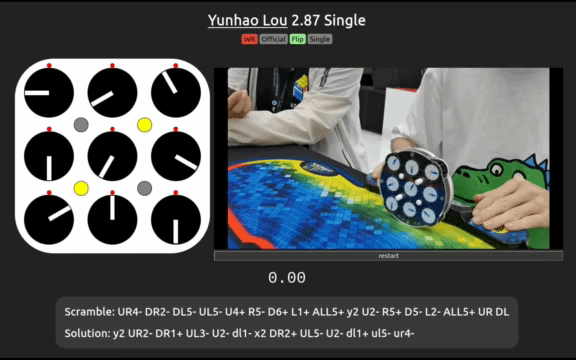

# ClockDB
https://clockdb.net

A website for users to create and share reconstructions of Rubik’s Clock solves, synchronized frame by frame with a video of the solve.

[](https://clockdb.net/r/0)

See this reconstruction in full quality at https://clockdb.net/r/0


## Table of Contents
- [Install](#install)
- [Usage](#usage)
- [Architecture](#architecture)
- [API](#api)
- [Maintainers](#maintainers)
- [Credits](#credits)

## Install
[(Back to top)](#table-of-contents)

This is for if you want to get it running locally. If not, skip this section! The only requirements are git and node. Here are the steps:
1. clone the repository:
  ```sh
  git clone https://github.com/JoshM2/ClockDB.git
  cd ClockDB
  ```
2. create a local copy of the database:
  ```sh
  npx wrangler d1 execute db --local --file=schema.sql
  ```
3. start the development server:
  ```sh
  npx wrangler pages dev
  ```
4. visit  http://localhost:8788


## Usage
[(Back to top)](#table-of-contents)

- **For visitors:**
Go to https://clockdb.net and explore the reconstructions. Start the YouTube video on a reconstruction to begin the animation.
- **For reconstructors:**
Visit https://clockdb.net/reconstruct and watch the video to learn how to make reconstructions.
- **For developers:**
Follow the instructions in the [­install](#install) section, and read the [architecture](#architecture) section to learn about how it works. If you want to contribute, please open an issue or contact me first to discuss your idea.
- **For everyone:** [Contact me](https://clockdb.net/contact) if you have any feedback or questions!

## Architecture
[(Back to top)](#table-of-contents)

This site was built with Cloudflare Pages Functions, Workers, D1, and KV.
#### /src
The /src folder has all of the static assets for the site. This includes static pages like the contact page as well as all of the JS, CSS, images, and fonts for the site.

#### /functions
The /functions folder has all of the non-static pages for the site. These are all made with Cloudflare Pages Functions. It uses file based routing, meaning that the /functions/r/[solve].js file will be what runs on the backend when you visit https://clockdb.net/r/1. Then the number “1” will be passed to the function so that the proper reconstruction can be fetched from the D1 SQL database, inserted into the page, and returned back to the user.

#### /workers
Some pages, like https://clockdb.net/lists/rankings-single are slow to generate. Therefore, the data that will be inserted into the page is generated once per day using a cron scheduled Cloudflare Worker. The worker stores the page data in Cloudflare KV (key-value) storage, so that requests can be quickly fulfilled without regenerating the page.
The /workers folder is for workers that generate these pages, with the exception of /workers/auth.js. This worker is hosted under the auth.clockdb.net subdomain and is used as the callback page for the WCA OAuth API. The docs for that can be found [here](https://docs.worldcubeassociation.org/knowledge_base/v0_api.html).

#### The database
There are six tables in the database:
- **reconstructions**: all of the reconstruction data
- **users**: user login data
- **saved**: where reconstructions in progress go if the user clicks the “save” button
- **queue**: where reconstructions go after someone submits a reconstruction.
- **archive**: submitted reconstructions also go here as a backup that I never edit. It exists as a backup because I frequently edit submissions in the queue table and delete submissions that have already been posted to the site.
- **removed_reconstructions**: I copy reconstructions to here from the reconstructions table so that no data is lost if a reconstruction needs to be removed from the site.

For more details, read the schema.sql file.

## API
[(Back to top)](#table-of-contents)

There are three categories of users: visitors, reconstructors, and admins. “Visitors” refers to anyone who is on the site, whether or not they are logged in. “Reconstructors” refers to anyone who has logged in with a WCA account. There is no restriction on who is able to become a reconstructor because all reconstructions must be approved by an admin before being published publicly on the site. “Admins” are users who have permission to view unpublished reconstructions and publish them. On login, users whose ID matches an ID specified in [this line](https://github.com/JoshM2/ClockDB/blob/99fa18be0b57bb14de039ad11a684617bc3df23a/workers/auth.js#L43) get their access level in the “users” SQL table set to 2. The access column is then used to verify permissions when a user tries to access an admin page.

#### Routes available to everyone:
- GET https://clockdb.net/
	The main page of the website, shows all published reconstructions. Has a search bar and tags 	you can filter by.
- GET https://clockdb.net/r/[solve id]
	Opens an individual reconstruction
- GET https://clockdb.net/persons/[person id]
	Shows all reconstructions for a particular solver

#### Routes only available to reconstructors and admins:
- GET https://clockdb.net/reconstruct/my-reconstructions
	Returns a page showing the user’s submitted and in progress reconstructions
- GET https://clockdb.net/reconstruct/new
	Opens the reconstruction tool with a new reconstruction
- GET https://clockdb.net/reconstruct/[reconstruction id]
	Opens the reconstruction tool and loads data from that user’s saved reconstruction. Requires 	you to be the owner of that reconstruction
- GET https://clockdb.net/reconstruct/duplicate-check/[youtube video id]
	Returns a list of reconstructions that have been made using the same YouTube video
- GET https://clockdb.net/reconstruct/save
	Saves the reconstruction in the “saved” SQL table so that the user can continue working on it 	later. Reconstruction data is sent as JSON in a cookie.
- GET https://clockdb.net/reconstruct/submit
	Saves the reconstruction in the “queue” SQL table so that an admin can publish the 	reconstruction to the site after review. Reconstruction data is sent as JSON in a cookie.

#### Admin users only:
- GET https://clockdb.net/q/
	Returns a page showing all the reconstructions in the “queue” SQL table.
- GET https://clockdb.net/q/[solve id]
	Opens the reconstruction page for a reconstruction in the queue.
- GET https://clockdb.net/q/accept/[solve id]
Copies the specified reconstruction from the “queue” SQL table to the “reconstructions” SQL table, returning a success message if it goes through

## Maintainers
[(Back to top)](#table-of-contents)

Joshua Marriott [(JoshM2)](https://github.com/JoshM2) is the sole maintainer of this project.

## Credits
[(Back to top)](#table-of-contents)

Thank you to everyone who has made a reconstruction. 
https://clockdb.net/top-reconstructors